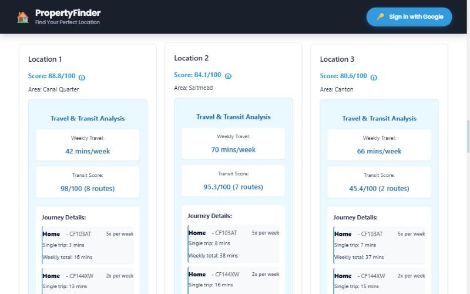
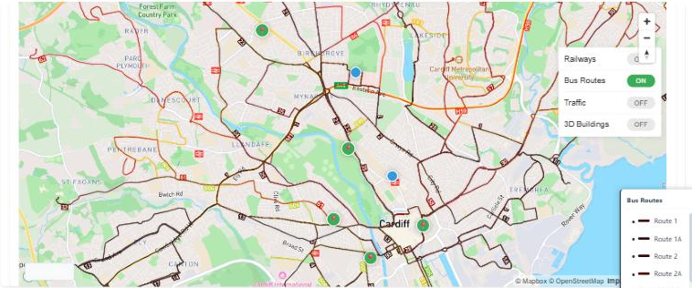
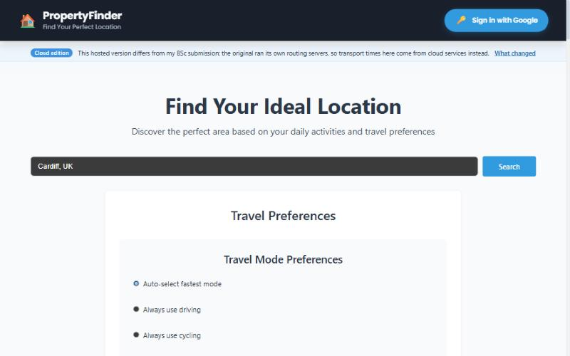
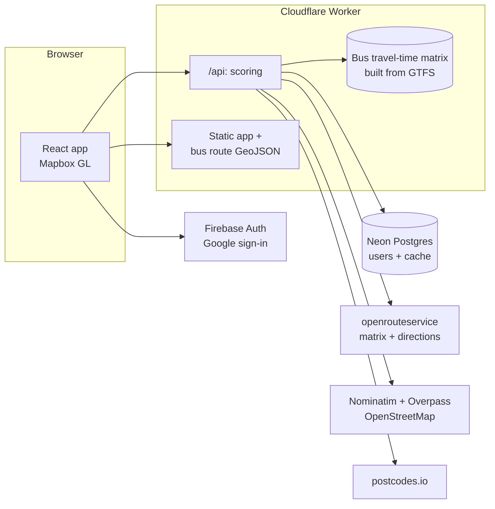

<div align="center">

# Location Score Analyzer

**Find the best area to live, scored on your own journeys.**
Tell it where you go each week and what matters to you. It samples locations across a city and ranks them on real travel times by car, bike, foot and bus, distance to schools, hospitals and supermarkets, and bus access.


[](LICENSE)

[**Try it live**](https://locationscore.aden.website) · [Demo video](https://youtu.be/dQODno6YMW4) · [How it works](#how-it-works) · [Cloud vs. BSc](#cloud-edition-vs-the-bsc-submission) · [Run it yourself](#run-it-yourself)



</div>

> [!NOTE]
> **This is the cloud edition of my BSc dissertation project, not the exact version I submitted.** The original ran OpenTripPlanner and OpenRouteService on my own servers and made hundreds of routing calls per search, which can't run on free cloud hosting. Here, bus times are pre-computed from the same timetable data and other routes use hosted APIs, so the scores differ from the dissertation. [What changed](#cloud-edition-vs-the-bsc-submission).

## What it does

| | |
|---|---|
|  |  |
| **Map view.** The top locations, your saved places and amenities on a Mapbox map, with layers for every Cardiff Bus route and stop, railways, traffic and 3D buildings, plus turn-by-turn routes between markers. | **Your priorities.** Add the places you travel to and how often, pick a travel mode (or let it choose the fastest), weight schools, hospitals and supermarkets, and choose primary or secondary schools. |

### Highlights

- **Real journey times.** Driving, cycling and walking from [openrouteservice](https://openrouteservice.org); bus journeys from Cardiff Bus timetables using RAPTOR, including walking to the stop and the average wait.
- **Auto mode.** Each destination uses whichever mode is fastest, and every alternative is shown.
- **Top-rated schools.** Locations near Cardiff's best-rated primary and secondary schools are flagged with their rank.
- **Full transparency.** Every score can be expanded into its raw data and formula.
- **Saved profile.** Sign in with Google to keep your destinations and preferences.

## How scoring works

Twenty random locations are sampled inside the city boundary and scored out of 100. The top five are shown.

| Component | Weight | Based on |
|---|---|---|
| **Travel** | 40% | Weekly travel time to your destinations (single trip × trips per week). Full marks at 0, zero at 10 hours a week. |
| **Amenities** | 40% (adjustable) | Distance to the nearest school (zero at 2 km), hospital (3 km) and supermarket (1 km), weighted by your settings. |
| **Transit** | 20% | Bus routes serving the nearest stop within 500 m (up to 70 points) and how close it is (up to 30). |

## How it works



- **One Worker serves everything.** The React app and the `/api` routes share an origin, so there are no hard-coded server addresses or CORS settings.
- **Bus routing without a routing server.** [`build-transit.mjs`](source-code/worker/scripts/build-transit.mjs) runs RAPTOR over the GTFS feed for a typical weekday morning (07:45 to 08:30) and saves a travel-time matrix between 531 stop clusters. A search looks journeys up instead of computing them, so it fits the Workers free plan.
- **Three routing calls per search.** One openrouteservice matrix request per mode covers every location × destination pair. The original made one request per pair.
- **Cached and self-healing.** City boundaries, amenities and postcodes are cached in Neon. If OpenStreetMap is unavailable, the last good copy is served. Without an ORS key or database, the app still works with estimated times.

| Layer | Tech |
|---|---|
| Hosting | Cloudflare Workers + static assets, at [locationscore.aden.website](https://locationscore.aden.website) |
| Frontend | React 18, Vite, React Router, Mapbox GL |
| API | TypeScript Worker ([`source-code/worker`](source-code/worker/src)) |
| Database | [Neon](https://neon.tech) Postgres via `@neondatabase/serverless` |
| Auth | Firebase Authentication (Google), verified in the Worker with `jose` |
| Data | OpenStreetMap, openrouteservice, Cardiff Bus GTFS, postcodes.io |

## Cloud edition vs. the BSc submission

The dissertation version needed servers on my home network. To host it permanently for free, those were replaced:

| | BSc submission | Cloud edition |
|---|---|---|
| **Bus journeys** | OpenTripPlanner server, live timetable queries | Pre-computed from a January 2025 Cardiff Bus timetable (RAPTOR, weekday morning) |
| **Car, bike, walking** | Self-hosted OpenRouteService, one request per journey | Hosted openrouteservice, one matrix request per mode |
| **Amenities** | OSMnx + GeoPandas in Python | Overpass queries, cached for 14 days |
| **Backend** | Python Flask | Cloudflare Worker (TypeScript) |
| **Saved data** | Firebase Firestore | Neon Postgres |

Two calculations were also corrected:
- Amenity distances are now true distances. The original measured them on a flat map projection, which made them about 1.6× too long at Cardiff's latitude.
- The travel score uses total weekly travel time, which is what the in-app formula always described.

The original code is unchanged in [`source-code/server`](source-code/server) for reference.

## Run it yourself

**You need** Node 20+, a free [Neon](https://neon.tech) database, a free [openrouteservice key](https://account.heigit.org/signup), a [Mapbox](https://account.mapbox.com) public token and a Cloudflare account. The database and ORS key are optional: without them the app runs with estimated times and no saved data.

```bash
git clone https://github.com/Arbzy1/location-score-analyzer.git
cd location-score-analyzer/source-code/worker
npm install
cp .dev.vars.example .dev.vars             # DATABASE_URL, ORS_API_KEY
cp ../client/.env.example ../client/.env   # VITE_MAPBOX_TOKEN
npm run build:client && npm run dev        # app + API on http://localhost:8787
```

To deploy, run `npx wrangler secret put DATABASE_URL` and `npx wrangler secret put ORS_API_KEY`, then `npm run deploy`. [DEPLOYMENT.md](DEPLOYMENT.md) covers every step, including the Firebase sign-in domain and refreshing the bus timetable.

<details>
<summary><b>Useful scripts</b> (in <code>source-code/worker</code>)</summary>

| Script | Purpose |
|---|---|
| `npm run dev` | Worker and built app on `localhost:8787` (run `npm run dev` in `client` too for hot reload) |
| `npm run deploy` | Build the React app and deploy the Worker |
| `npm run build:transit -- <GTFS dir>` | Rebuild the bus travel-time matrix and route map from a GTFS feed |
| `npm run typecheck` | TypeScript check |
| `npx wrangler tail` | Live logs from production |

</details>

## Project layout

```
source-code/
  client/          React app (Vite, Mapbox GL)
  worker/          Cloudflare Worker: API, scoring, routing, Neon access
    scripts/       GTFS -> bus travel-time matrix (RAPTOR)
    src/data/      Generated transit data bundled with the Worker
  server/          Original BSc Flask backend, GTFS feed and top-school lists
docs/              Original design docs (API, architecture, testing, transparency)
DEPLOYMENT.md      Cloud setup guide
```

## Credits and license

Map data © [OpenStreetMap](https://www.openstreetmap.org/copyright) contributors. Routing by [openrouteservice](https://openrouteservice.org) (HeiGIT). Bus timetables from Cardiff Bus via the [Bus Open Data Service](https://data.bus-data.dft.gov.uk/). Postcodes by [postcodes.io](https://postcodes.io). Basemap by [Mapbox](https://www.mapbox.com).

Built by Aden Butt as a BSc dissertation project. Released under the [MIT License](LICENSE).
